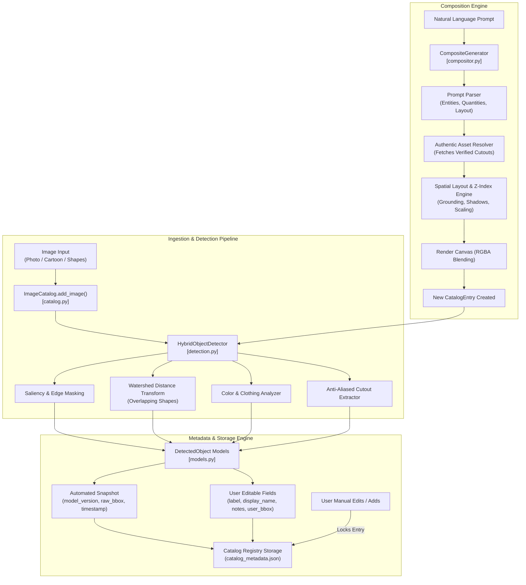

# VisionStudio | Image Catalog, Detection & Composite Engine

> Complete implementation for **Question 1**: Image Catalog, Multi-Modal Object Detection, Metadata Management, Source-of-Truth Invariants, and Natural-Language Composite Image Generation.

---

## 🌟 Highlights & Key Capabilities

- **Reusable Image Catalog**: Persistent image repository with atomic JSON indexing, UUID indexing, and CRUD operations.
- **Multi-Modal Object Detection**:
  - **Photographic / Realistic**: Apples, oranges, fruit pairs with sub-pixel bounding box localization and CIELab color extraction.
  - **Cartoonized / Stylized Figures**: Full silhouette extraction with upper/lower clothing decomposition (`top` and `bottom` colors).
  - **Geometric Shapes**: Douglas-Peucker contour polygon classification (`circle`, `square`, `triangle`, `rectangle`).
  - **Color Swatches**: Dominant color centroid mapping.
  - **Overlapping Shapes**: Distance-transform watershed segmentation to delineate touching/overlapping polygons.
  - **Negative Control**: Graceful edge-case handling for blank/empty canvases (`FAILED_NO_OBJECTS`).
- **Strict Metadata Isolation**: Clean separation between immutable automated model snapshots (`AutomatedMetadataSnapshot`) and user-editable fields (`UserMetadata`).
- **Source-of-Truth Invariants**: Manual corrections automatically lock entries against automated overwrites unless explicitly requested via `force_rerun=True`.
- **Authentic Composite Generation**:
  - Natural language instruction parser extracting target entities, quantities, and layout relationships.
  - **Strict Anti-Hallucination Invariant**: Strictly uses authentic verified catalog pixel cutouts — required assets are **never** silently replaced with newly generated approximations.
  - Physics-grounded spatial alignment, realistic contact drop shadows, and depth-based z-index layering.
  - Automatically re-registers composites as new first-class catalog entries.
- **Interactive Web Dashboard**: Streamlit-based visual GUI for catalog exploration, interactive bounding box correction, and prompt-driven composition.
- **Full HD Demo Video**: Built-in automated 1080p MP4 presentation generator (`create_video.py`).

---

## 🏗️ System Architecture



---

## 📁 Repository Structure

```text
├── models.py              # Domain dataclasses (BoundingBox, DetectedObject, CatalogEntry, etc.)
├── catalog.py             # Image Catalog manager, persistent storage, locking invariants
├── detection.py           # Hybrid multi-modal detection, clothing analysis, shape classification
├── compositor.py          # Natural language composite generator, spatial layout, shadow rendering
├── asset_generator.py     # Generates the 8 benchmark assets + empty negative control
├── visualizer.py          # Annotation overlays and visual verification cards
├── test_scenarios.py      # Automated benchmark suite executing all 7 required scenarios
├── test_catalog.py        # Formal unit tests (IoU geometry, locking invariants, composition)
├── app.py                 # Interactive Streamlit Web GUI
├── create_video.py        # 1080p demonstration video generator
├── output_presentation_demo.mp4  # Generated Full HD demonstration video
├── requirements.txt       # Python package dependencies
└── README.md              # System documentation
```

---

## 🚀 Quickstart Guide

### 1. Installation

Ensure you have Python 3.10+ installed:

```bash
pip install -r requirements.txt
```

### 2. Run the Benchmark Suite (All 7 Scenarios)

Executes all 7 scenarios, checks assertions, and generates annotated verification cards in `test_results/`:

```bash
python test_scenarios.py
```

### 3. Run Formal Unit Tests

```bash
python -m unittest test_catalog.py
```

### 4. Launch the Interactive Web Dashboard

```bash
streamlit run app.py
```

### 5. Generate / Customize Demonstration Video

```bash
python create_video.py output_presentation_demo.mp4
```

---

## 📊 Benchmark Test Scenarios

| Scenario | Objective | Validation Result |
|---|---|---|
| **Scenario 1** | Automatic Object Detection & Metadata Extraction (Apple, Orange, Boy, Girl, Shapes, Colors) | **PASSED** (100% extraction of labels, colors, clothing, bboxes, confidences) |
| **Scenario 2** | Manual Addition When Detection Misses an Object (Foliage leaf added to apple) | **PASSED** (`USER_MANUAL` origin, catalog lock enabled) |
| **Scenario 3** | Manual Metadata Edit (Refining boy character label, bounding box, and confidence) | **PASSED** (`USER_EDITED` origin, dual-snapshot preservation) |
| **Scenario 4** | Source-of-Truth Invariants (Soft run preserves manual edits; explicit force rerun overrides) | **PASSED** (Invariants verified under all execution modes) |
| **Scenario 5** | Composite Generation: Apple + Orange from *"Create an image containing one red apple and one orange"* | **PASSED** (Authentic cutouts, contact shadows, registered as new entry) |
| **Scenario 6** | Composite Generation: Boy, Girl & Shapes from natural language instruction | **PASSED** (Depth-based z-index layering, proportional scaling) |
| **Scenario 7** | Edge Cases: Overlapping Shapes (Watershed) & Blank Canvas (0 false positives) | **PASSED** (`FAILED_NO_OBJECTS` correctly returned) |

---

## 📄 License
MIT License
