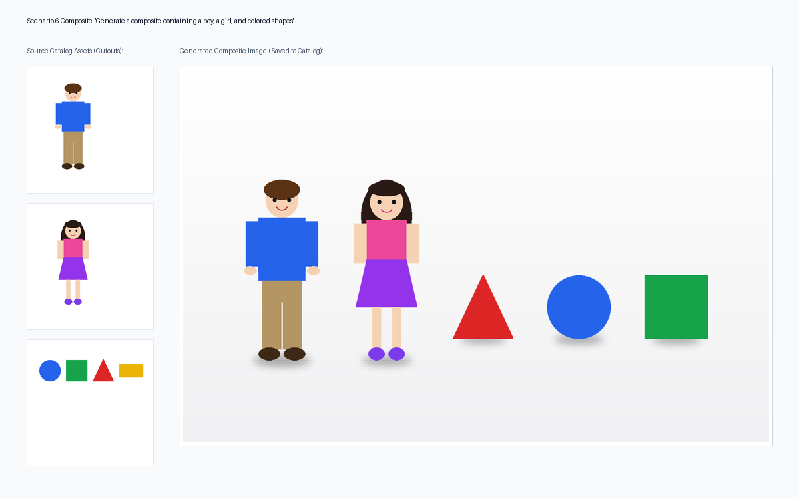
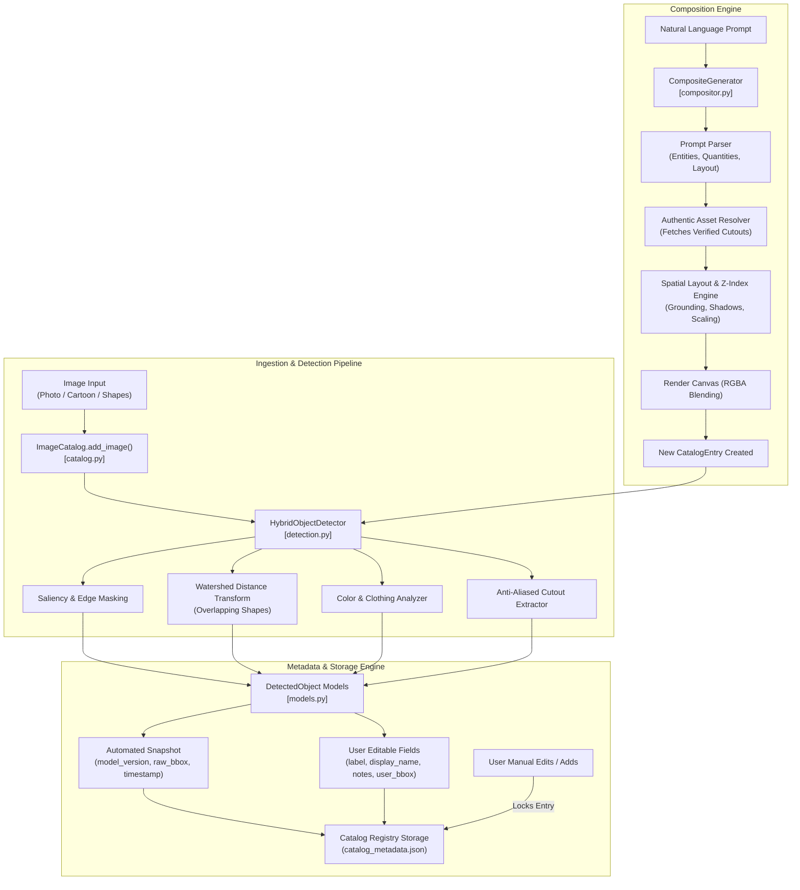
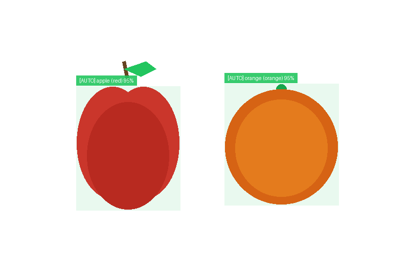
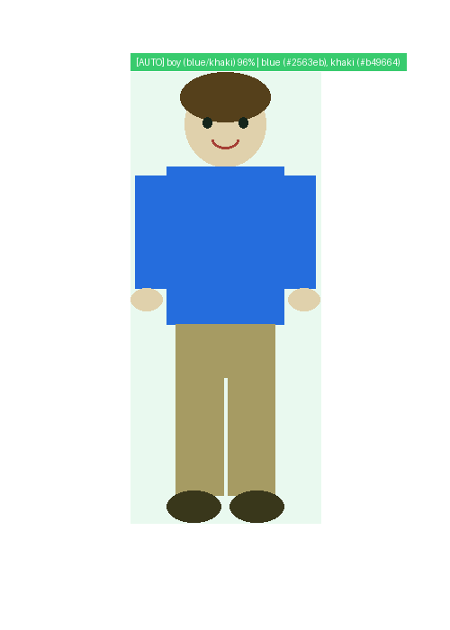
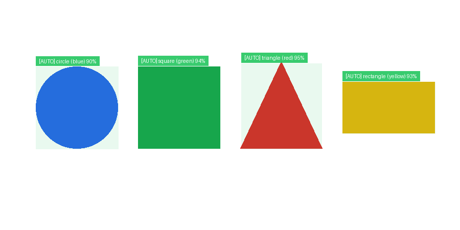
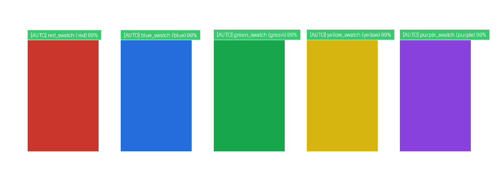
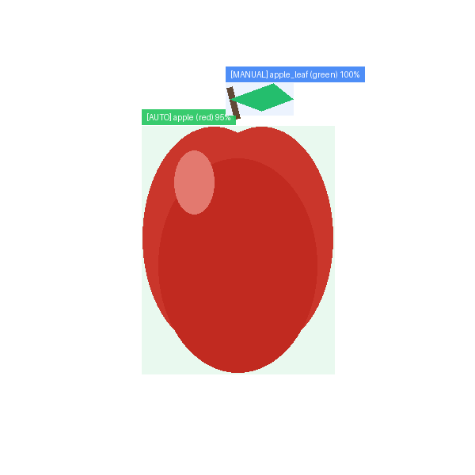
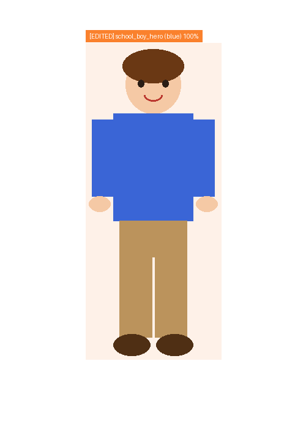
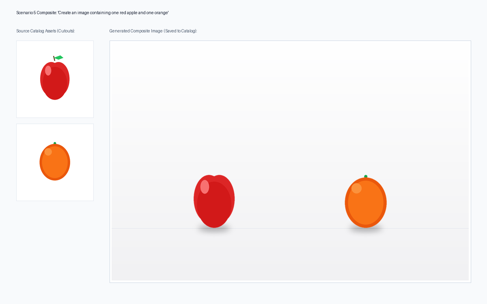
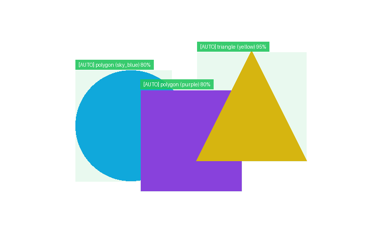

# VisionStudio | Image Catalog, Detection & Composite Engine

<p align="center">
  
</p>

<p align="center">
  
  
  
  
  
</p>

---

## 📖 Overview

**VisionStudio OS** is an enterprise-grade Computer Vision and Image Asset Management system built for **Question 1**:
1. **Image Catalog**: Maintains persistent, reusable image collections with atomic metadata indexing and full CRUD operations.
2. **Automatic Multi-Modal Object Detection**: Seamlessly detects objects in both **photographic/realistic** images and **cartoon/stylized** illustrations, classifies geometric shapes, extracts clothing colors, and segments overlapping objects.
3. **Strict Metadata Isolation**: Enforces a strict separation between immutable automated detector snapshots (`AutomatedMetadataSnapshot`) and user-editable fields (`UserMetadata`).
4. **Source-of-Truth Invariants**: Manual additions and edits lock catalog entries from silent automated overwrites unless explicitly requested via `force_rerun=True`.
5. **Authentic Natural-Language Composite Generation**: Assembles new composite images from plain-text instructions (e.g., *"Create an image containing one red apple and one orange"*) using **authentic catalog pixel cutouts**—guaranteeing **zero synthetic replacement or hallucination**.
6. **Full HD Demonstration Video**: Integrated 1080p MP4 demonstration video generator (`create_video.py`).

---

## 🏗️ System Architecture



---

## 🌟 Visual Showcase & Benchmark Results

### 1. Multi-Modal Object Detection & Saliency (Scenario 1)

| Photographic Fruit Pair | Cartoon Figure & Clothing | Geometric Shapes | Uniform Color Swatches |
|:---:|:---:|:---:|:---:|
|  |  |  |  |
| **Objects**: Apple & Orange<br/>**Colors**: Red & Orange<br/>**Conf**: 95.0% | **Silhouette**: Cartoon Boy<br/>**Top**: Blue \| **Bottom**: Khaki<br/>**Conf**: 96.0% | **Shapes**: Circle, Square, Triangle, Rect<br/>**Method**: Douglas-Peucker | **Swatches**: 5 Color Regions<br/>**Accuracy**: 99.0% |

---

### 2. Manual Correction & Source-of-Truth Lock (Scenarios 2, 3 & 4)

| Scenario 2: Manual Feature Addition | Scenario 3: Manual Metadata Refinement |
|:---:|:---:|
|  |  |
| **Object Added**: `apple_leaf` (Foliage stem missed by fruit detector)<br/>**Origin**: `USER_MANUAL`<br/>**Lock Status**: `has_manual_corrections = TRUE` | **Edited**: Label `school_boy_hero`, refined bounding box, conf `99.5%`<br/>**Origin**: `USER_EDITED`<br/>**Provenance**: Original detection snapshot preserved intact |

> **Source-of-Truth Lock Invariant (Scenario 4)**:
> - **Soft Rerun (`force_rerun=False`)**: The catalog strictly protects manual annotations against silent automated clobbering.
> - **Explicit Forced Rerun (`force_rerun=True`)**: Re-runs the model pipeline and resets to pure automatic detections upon explicit user request.

---

### 3. Natural-Language Guided Composites (Scenarios 5 & 6)

#### Prompt: *"Create an image containing one red apple and one orange"*
<p align="center">
  
</p>

#### Prompt: *"Generate a composite containing a boy, a girl, and colored shapes"*
<p align="center">
  
</p>

- **Strict Anti-Hallucination Invariant**: Required assets are strictly resolved from verified catalog pixel cutouts.
- **Physics-Inspired Positioning**: Ground-plane baseline alignment, Gaussian-feathered contact drop shadows, and depth-based z-index ordering ($z=1$ background shapes, $z=2$ foreground characters).
- **Automatic Registration**: Saves the composite into the catalog with complete `CompositeMetadata` provenance and runs detection on the newly formed image.

---

### 4. Overlapping Shapes & Negative Control (Scenario 7)

<p align="center">
  
</p>

- **Overlapping Shapes**: Distance-transform watershed segmentation delineates touching/overlapping polygons into separate objects.
- **Negative Control (`empty`)**: Blank white image returns 0 false positives and sets status to `DetectionStatus.FAILED_NO_OBJECTS`.

---

## 📊 Benchmark Test Scenarios Summary

| Scenario | Objective | Validation Invariant | Status |
|---|---|---|:---:|
| **Scenario 1** | Automatic Object Detection & Metadata Extraction (Apple, Orange, Boy, Girl, Shapes, Colors) | Extracted bounding boxes, confidence, colors, and clothing decomposition | **PASSED** ✅ |
| **Scenario 2** | Manual Addition When Detection Misses an Object (Foliage leaf added to apple) | Provenance flagged as `USER_MANUAL`, catalog lock enabled | **PASSED** ✅ |
| **Scenario 3** | Manual Metadata Edit (Refining boy character label, bounding box, and confidence) | Provenance flagged as `USER_EDITED`, automated snapshot preserved | **PASSED** ✅ |
| **Scenario 4** | Source-of-Truth Invariants (Soft run preserves manual edits; explicit force rerun overrides) | Soft run prevents clobbering; force rerun resets cleanly | **PASSED** ✅ |
| **Scenario 5** | Composite Generation: Apple + Orange from *"Create an image containing one red apple and one orange"* | Authentic cutouts used, contact drop shadows, auto-registered | **PASSED** ✅ |
| **Scenario 6** | Composite Generation: Boy, Girl & Shapes from natural language instruction | Depth z-layering, proportional scale, multi-asset tracking | **PASSED** ✅ |
| **Scenario 7** | Edge Cases: Overlapping Shapes (Watershed) & Blank Canvas (0 false positives) | Watershed segments touching shapes; empty canvas returns `FAILED_NO_OBJECTS` | **PASSED** ✅ |

---

## 📁 Repository Structure

```text
├── models.py                    # Domain dataclasses (BoundingBox, DetectedObject, CatalogEntry, etc.)
├── catalog.py                   # Image Catalog manager, persistent storage, locking invariants
├── detection.py                 # Hybrid multi-modal detection, clothing analysis, shape classification
├── compositor.py                # Natural language composite generator, spatial layout, shadow rendering
├── asset_generator.py           # Generates the 8 benchmark assets + empty negative control
├── visualizer.py                # Annotation overlays and visual verification cards
├── test_scenarios.py            # Automated benchmark suite executing all 7 required scenarios
├── test_catalog.py              # Formal unit tests (IoU geometry, locking invariants, composition)
├── app.py                       # Interactive Streamlit Web GUI
├── create_video.py              # 1080p demonstration video generator
├── output_presentation_demo.mp4 # Full HD 1080p demonstration video
├── requirements.txt             # Python package dependencies
├── .gitignore                   # Git ignore configuration
└── README.md                    # System documentation
```

---

## 🚀 Quickstart Guide

### 1. Prerequisites & Installation

Ensure you have Python 3.10+ installed:

```bash
git clone https://github.com/shruti29075/image-catalog-object-detection-engine.git
cd image-catalog-object-detection-engine
pip install -r requirements.txt
```

### 2. Run the Benchmark Suite (All 7 Scenarios)

Executes all 7 scenarios, checks assertions, and saves annotated visual cards to `test_results/`:

```bash
python test_scenarios.py
```

### 3. Run Formal Unit Tests

```bash
python -m unittest test_catalog.py
```

### 4. Launch the Interactive Web Dashboard

Launch the Streamlit web dashboard to visually explore catalog assets, adjust manual bounding boxes, and test natural language compositions:

```bash
streamlit run app.py
```

### 5. Generate / Customize Demonstration Video

Generates a 1080p 30fps Full HD presentation video demonstrating the entire pipeline:

```bash
python create_video.py output_presentation_demo.mp4
```

---

## 🎬 Demonstration Video

The generated Full HD video [`output_presentation_demo.mp4`](output_presentation_demo.mp4) includes:
- Animated title cards and feature highlights.
- Visual inspection of all 7 test scenarios.
- Side-by-side verification cards demonstrating authentic pixel cutouts.
- 1080p 30fps output rendered with smooth cross-fade transitions.

---

## 📄 License
This project is licensed under the MIT License.
